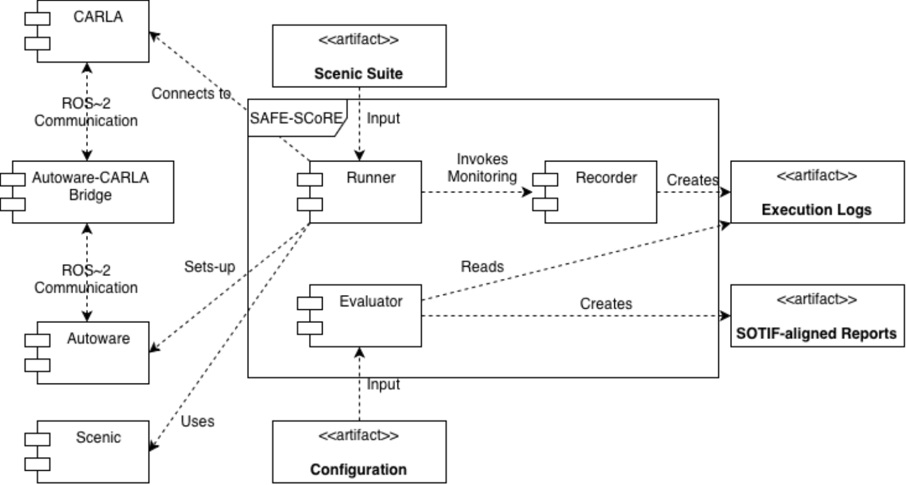

# Architecture

How the SAFE-SCoRE code is organized and how its parts interact. For what the tool does and how to run it, see the [README](README.md).

## Overview

SAFE-SCoRE has two stages that communicate only through **base logs** (one JSON file per scenario execution):

- **Execution stage** (`src/runner/`, `src/data_gathering/`): executes Scenic scenarios on CARLA and writes the base logs. Components: Runner and Recorder.
- **Evaluation stage** (`src/pipeline/`, `src/data_gathering/enriching/`, `src/analysis/odd_tc_coverage.py`): enriches the base logs and writes the reports. Component: Evaluator.

`run_experiment.py` runs both stages. `run_pipeline.py` runs only the evaluation, on logs that already exist in `outputs/<name>/`. Any tool that writes base logs of the same shape can use the evaluation (see [docs/integration.md](docs/integration.md)).

All Python code is under `src/`, in the packages `runner`, `converter`, `data_gathering` (with `enriching`), `pipeline`, `analysis` and `utils`. `src/` itself is not a package (no `src/__init__.py`), so code **inside** `src/` imports across packages without a `src.` prefix (`from utils.carla_help import ...`). The `src.` prefix appears only in the command line, `python -m src.<package>.<module>`, run from the repository root. Each entry script (`run_experiment.py`, `run_pipeline.py`) puts the repository root and `src/` on `sys.path`, so it also works as `python src/<package>/<script>.py`. Non-code assets stay at the root: `config/`, `maps/`, `scenic_example/`, `outputs/`, `docs/`.

## Environment

- Python 3.10, Scenic installed from source (see the README), `carla==0.9.15` from `requirements.txt`. A CARLA server must be reachable: SAFE-SCoRE does not bundle one.
- `src/utils/carla_help.py` holds helpers used by the Recorder (collision analysis, speed) and helpers for external integrations (connecting to and restarting CARLA, which read the `CARLA_PATH` environment variable). The Runner manages CARLA through `--carla_exe` instead.
- There is no test suite, linter configuration or CI.

## Execution stage

### Entry point: `src/runner/run_experiment.py`

Parses the command line (all flags are in the README), builds a `ScenicCarlaRunner`, runs the suite, prints the summary, and then runs the evaluation on the output folder it produced (not on other folders under `outputs/`), unless `--skip_enrichment` is given. In a `finally` block it stops what the Runner started (camera, Autoware, CARLA). It enables `faulthandler`, because the CARLA client library can abort the interpreter without a Python traceback.

### Runner: `src/runner/scenic_carla_runner.py`

For each scenario, `run_file()`:

1. Reads the scenario duration from its `terminate after N seconds` statement and the map from its `param map = localPath(...)`. A stock CARLA town (`Town<N>`) is loaded by name; any other map is ingested as raw OpenDRIVE.
2. With `--driver autoware`, brings the environment up first and checks that the scenario's map is the one Autoware runs. Mismatching scenarios are skipped and listed in the summary.
3. Writes a temporary copy of the scenario with the map path made absolute and the Recorder monitor appended (see below).
4. For each of the `--num_runs` runs, makes up to `--max_run_attempts` attempts. Each attempt performs the **pre-flight check** (`environment_healthy()`: CARLA reachable; with Autoware also ROS 2 nodes alive, no duplicate ROS nodes, one tick equals one timestep), recovers the environment if needed (`_recover()`), and executes the run.
5. A run is successful when it left a base log. If all attempts fail, the scenario is discarded and the logs of its earlier runs are kept.

**Each run executes in its own OS process** (`_run_once_worker`). The CARLA client library can hang forever on a dead server, or abort the process on a stale world handle. Isolating the run lets the parent kill the worker after `--max_wall_seconds` plus a grace period, read its exit code, and retry. The same rule applies to everything else that holds a CARLA connection: the Autoware startup tick pump, the clock check and the spectator camera each run in a child process.

**Recovery always restarts both CARLA and Autoware.** A CARLA crash strands Autoware on a dead connection, and restarting Autoware against a live CARLA makes it reload the map CARLA already has, which crashes the engine. CARLA is killed by image name and the Runner waits until no CARLA process remains, because `CarlaUE4.exe` is only a launcher and a second server on port 2000 breaks everything silently.

Within a worker the Runner compiles the scenario with Scenic (`model="scenic.simulators.carla.model"`), samples a scene, builds a `CarlaSimulator`, and calls `simulate()`. The map-ingestion mesh settings (`OPENDRIVE_MESH_PARAMS`) and the spawn diagnostics are applied as temporary patches over the CARLA client, undone afterwards.

### Recorder: `src/runner/recorder.py`, `src/data_gathering/`

Scenic's `simulate()` owns the tick loop, so there is no external per-tick hook. The Runner therefore appends a Scenic `monitor` to the temporary scenario copy; the monitor calls `on_monitor_step()` once per simulated step. On its first call, `on_monitor_step()` builds, from the live ego actor:

- a `CarlaBasicLogger` (`carlaBasicLogger.py`): holds the log, registers the ego and the other dynamic actors, appends one frame per step (location, rotation, velocity, bounding-box vertices), counts events, and saves the JSON in `finalize_and_save()`;
- a `ViolationMonitor` (`violationMonitor.py`), ticked by the logger every frame: red light, stop sign, speeding and off-road detectors;
- a collision sensor and a lane-invasion sensor attached to the ego. A collision is classified as `collision_vehicle`, `collision_pedestrian` or `collision_static`, and consecutive contacts with the same actor are counted once;
- the `world_state` snapshot (`snapshot_world_state()`): raw CARLA weather values, number of NPC vehicles and pedestrians, ego speed limit, scenario timeout. It is what the ODD and TC evaluation reads.

`on_monitor_step()` also enforces the real-time cap (`RunWallClockTimeout`) and, in Autoware mode, polls for arrival at the goal (`GoalReached`). The worker saves the log in a `finally` block, so a run stopped by either exception still produces a log.

### Autoware mode: `autoware_session.py`, `autoware_control.py`, `goal_planner.py`

Ownership is split. **Autoware** owns the map, the ego, its sensors and its control. **Scenic** owns the clock and every other actor. **SAFE-SCoRE** decides where the ego starts and where it goes, and logs. Autoware's bridge is stopped from ticking by `CARLA_EXTERNAL_TICK=1` (the patch in the README), so exactly one client ticks.

- `autoware_session.py` — `AutowareSession` prepares each run: teleports the ego to the sampled scene's pose, waits until it is at rest, initializes localization, sets a goal (resampling if Autoware refuses it), and engages autonomous mode. `autoware_ownership()` is a context manager applying six temporary patches over Scenic and CARLA, so that Scenic does not reload the map, binds the scene's ego to Autoware's existing actor instead of spawning a second one, cannot control that actor, ticks at real-time pace, and does not destroy the ego or leave synchronous mode between runs. `TickPump` ticks the world in the background between the moment the Runner takes the clock and the moment Scenic's loop starts, because Autoware cannot finish its own startup without ticks.
- `autoware_control.py` — `AutowareController`: every ROS 2 call (initial pose, localization, route, engage, stop, readiness and health queries) is issued as `wsl.exe -e bash -lic "ros2 ..."`. Each call costs about a second.
- `goal_planner.py` — a scenario has no destination, so `compute_goal()` derives one: the ego follows its lane in CARLA's waypoint graph, takes a uniformly random branch at each junction, and stops after the distance it could cover in the scenario's time limit (a fraction of it, `REALISM_FACTOR`, using Autoware's actual speed and acceleration limits), then steps clear of any junction. The random generator is seeded per scenario, run and attempt.

### Spectator camera: `follow_camera.py`

An observer-only process that moves CARLA's spectator behind, above or in front of the ego. It never ticks. It is stopped before every environment restart and started again afterwards.

## Evaluation stage

### Entry points: `src/pipeline/run_pipeline.py`, `sotif_pipeline.py`

`SOTIFPipeline.run()` processes each dataset folder (`outputs/<name>/`, or every folder with `--all`; a folder without base logs is skipped). For each folder it runs these steps as subprocesses, in order:

| Step | Script | Writes |
|---|---|---|
| 0.5 | `data_gathering/enriching/orchestrator.py` | `results.critical_metrics`, `functional_metrics`, `dynamics_metrics` in each log (in place) |
| A | `data_gathering/enriching/compute_sotif_odd.py` | `sotif.odd_values`, `sotif.triggering_conditions` in each log; `odd_scores.csv` |
| B | `data_gathering/enriching/compute_sotif_hazard.py` | `final_hazard_report.csv` |
| C | `data_gathering/enriching/compute_execution_time_report.py` | `final_execution_time_report.csv` |
| D | `analysis/odd_tc_coverage.py` | `odd_coverage_entropy_final_report.csv`, `odd_coverage_detail_final_report.csv`, `tc_coverage_detail_final_report.csv` |

Steps A to D share one CLI shape: `--dataset_dir <folder>`, output written inside that folder, invoked through `SOTIFPipeline._run_script()`. A new step of this shape is added by writing such a script and one `_run_script(...)` call. Step 0.5 has its own CLI (`--input_dir`, `--output_dir`, `--workers`) and its own method, `compute_enriched_metrics()`. Each step is described in [docs/sotif_pipeline.md](docs/sotif_pipeline.md).

### Enrichment: `src/data_gathering/enriching/`

`orchestrator.py` processes all logs in parallel (at most 60 workers, the Windows limit). For each log it first runs `log_normalization.py` (`normalize_events`, `ensure_event_counts_schema`), which reconciles event names and frame/timestamp conventions, and then the three analyzers: `critical.py` (MDBV, TTC, TET), `functional.py` (route following) and `dynamic.py` (speed and acceleration). Reuse `log_normalization.py` rather than reading raw event fields in new enrichment code. Metric definitions are in [docs/enrichment.md](docs/enrichment.md).

### Configuration: `config/sotif_odd_tc.yaml`

Hazards (severity and acceptance threshold), ODD factors and triggering conditions live in this file, loaded and validated by `sotif_config.py`, which `compute_sotif_odd.py`, `compute_sotif_hazard.py` and `odd_tc_coverage.py` share. `compute_derived_fields()` in `compute_sotif_odd.py` is the only place where raw `world_state` facts become the categorical values the configuration refers to (`derived.*`).

### Coverage: `src/analysis/odd_tc_coverage.py`

Counts, per scenario, the union of the ODD values and TCs observed over its runs, then computes coverage and normalized entropy against the declared values (definitions in the README, Output section).

### Offline research scripts

`src/analysis/` also holds scripts that compare suites across tools (`rq1_*`, `rq2_*`, `rq4_*`, `rq_efficiency_*`, driven by `run_analysis.py`), and `src/pipeline/` holds clustering, scoring and plotting scripts (`clustering.py`, `scores.py`, `graphs.py`, `run_comparison.py`, `umap_kmeans_rq3.py`, `merge_feature_vectors.py`). `compute_feature_vectors.py` (with `feature_extraction.py`) and `risk_enrichment.py` in `enriching/` are standalone scripts of the same kind. None of them is run by SAFE-SCoRE. They read different file layouts from each other, so check which one a given CSV belongs to before extending them. See [docs/analysis_pipeline.md](docs/analysis_pipeline.md).

## Base log data model

One JSON file per execution, named `<scenario_id>_run_<NN>_log_basic.json` (the evaluation steps B to D select files with this pattern). Top level:

- `tool`, `generation_id`, `scenario_id`, `map_name`, `run_index`, `delta_time`, `start_time`: run metadata. The Runner sets `tool` to the output folder name and `generation_id` to the driver (`behavior_agent` or `autoware`).
- `world_state`: facts recorded at the start of the run, input of the ODD and TC evaluation.
- `frames`: one entry per simulation step with the ego and every other dynamic actor.
- `actors`: the registry of dynamic actors (type, role, spawn pose).
- `events`: details of every detected event; `results.events` holds a normalized copy.
- `mission`: route information, filled only by integrations that call `set_mission_from_agent()`; SAFE-SCoRE's Runner leaves it empty.
- `results.event_counts`, `results.has_*`, `results.total_frames`, `results.total_wall_clock_time`, `results.simulated_time`: written by the Recorder.
- `results.critical_metrics`, `results.functional_metrics`, `results.dynamics_metrics`: written by step 0.5.
- `sotif.odd_values`, `sotif.triggering_conditions`: written by step A.

The annotated schema is in [docs/base_log_json.md](docs/base_log_json.md).

## Adding a scenario source or another tool

Any tool whose CARLA loop uses `CarlaBasicLogger` and `ViolationMonitor` as `src/runner/recorder.py` does can use the evaluation: [docs/integration.md](docs/integration.md).
