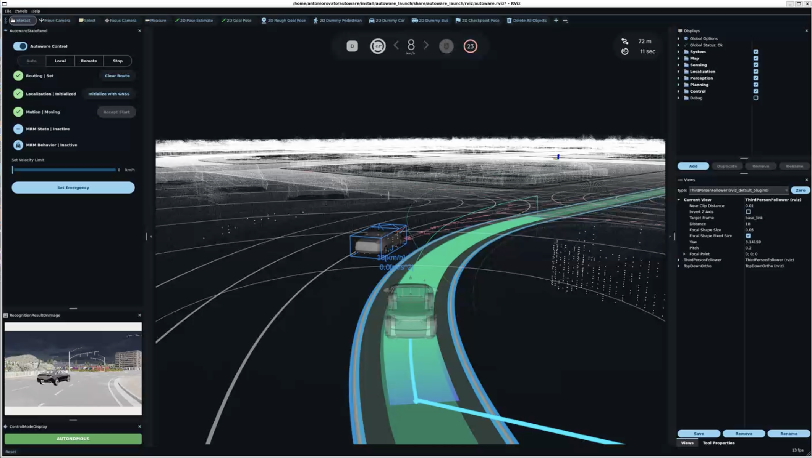
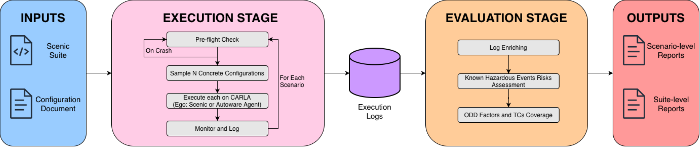

# SAFE-SCoRE: a SOTIF-Aligned Framework for the Evaluation of Scenario Coverage of Risks and their Efficiency



SAFE-SCoRE executes a suite of [Scenic](https://scenic-lang.readthedocs.io) driving scenarios in the
[CARLA](https://carla.org) simulator and turns every execution into evidence aligned with
[ISO 21448 (SOTIF)](https://www.iso.org/standard/77490.html): the residual risk of each known
hazardous event, the execution time of each scenario, and the coverage of the Operational Design Domain (ODD)
factors and triggering conditions (TCs) of the whole suite.

The ego vehicle is driven either by the behavior written in the Scenic scenario or by the
[Autoware](https://autoware.org) autonomous driving stack, so the same suite can evaluate an actual system under test.

A walkthrough video is available [here](https://youtu.be/eupKd7sjudQ).

---

## Why

ISO 21448 asks developers to find known and unknown hazardous events of their system, estimate the risk of each one,
and reduce it until the residual risk is acceptable. Simulating many scenarios is the standard way to collect the
data for this, but *running* scenarios does not produce that evidence. Three things are missing, and SAFE-SCoRE provides each of them:

- **A Scenic scenario is a probability distribution, not one situation.** A scenario fixes the structure of a
  situation (road layout, actors, behaviors) and leaves parameters such as speeds, distances and weather random.
  One execution therefore says almost nothing. SAFE-SCoRE samples the scenario *N* times and estimates the probability
  of each hazardous event as the fraction of the *N* executions in which it happened.
- **The evidence must be uniform and tied to SOTIF concepts.** Every execution produces the same log, and
  every log is evaluated against the same declarative configuration: which ODD factors and values exist, which
  triggering conditions can fire, which hazardous events to monitor, and how severe and how acceptable each one is.
- **The simulation environment crashes.** On Town05 with Autoware attached, we measured 33 CARLA crashes in one
  working day and Autoware node deaths in 11 of 14 launches ([details](docs/KNOWN_INSTABILITIES.md)). A campaign that
  silently loses runs yields wrong statistics, so SAFE-SCoRE detects the failure, restarts CARLA and Autoware, and retries the run.

SAFE-SCoRE does not generate scenarios: any Scenic suite works, whether hand-written or generated though some tool. It does not search for unknown hazardous events either: scenarios are sampled randomly from their distribution.

---

## How it works



SAFE-SCoRE takes two **inputs**: a **suite of Scenic scenarios** and a **configuration document**
([`config/sotif_odd_tc.yaml`](config/sotif_odd_tc.yaml)) that declares the ODD factors, the triggering conditions and the known hazardous events
(with their severity and acceptance threshold). It works in two stages that communicate only through log files:

1. **Execution stage.** For each scenario, SAFE-SCoRE checks the environment, samples *N* concrete instances,
   executes each one in CARLA, and writes one execution log per run.
2. **Evaluation stage.** SAFE-SCoRE enriches the logs with derived variables, assesses the risk of each known hazardous event,
   and computes the coverage of ODD factors and TCs. It produces **scenario-level** and **suite-level reports**.

One command runs both stages. Because the stages only share log files, the evaluation can also be run alone on the
logs of another tool (see [docs/integration.md](docs/integration.md)).


SAFE-SCoRE has three components. The first two belong to the execution stage, the third to the evaluation stage.

**Runner** ([`src/runner/`](src/runner)) orchestrates the execution of the suite.
- It connects to CARLA, samples each Scenic scenario *N* times, and executes each instance step by step.
  Scenic always owns the simulation clock and the other actors.
- It supports two driving agents for the ego vehicle. With the **behavior agent** (default), the ego follows the behavior
  written in the Scenic scenario. With **Autoware**, the Runner sets Autoware up through ROS 2 (start pose, speed limit, goal, engagement),
  while Scenic keeps controlling every other actor. The Autoware-CARLA bridge connects Autoware to CARLA.
- Before each run it performs a **pre-flight check** (CARLA reachable; with Autoware: ROS 2 nodes alive, no stale nodes, simulation clock sane).
  If a check or a run fails, it restarts CARLA and Autoware and re-samples the scenario, up to `--max_run_attempts` times (5 by default).
  If all attempts fail, the scenario is discarded and only its successful executions are reported.

**Recorder** ([`src/data_gathering/`](src/data_gathering), [`src/runner/recorder.py`](src/runner/recorder.py)) monitors every execution.
- It is attached to the scenario as a Scenic monitor and runs at every simulation step.
- It stores the *world state* (raw facts: weather, number of vehicles and pedestrians, speed limit, timeout) and, frame by frame,
  the state of the ego and of every other actor.
- It runs one detector for each known hazardous event (collisions, red light, stop sign, off-road, lane invasion) and counts its occurrences.
- At the end of the run it saves everything as one JSON log.

**Evaluator** ([`src/pipeline/`](src/pipeline), [`src/data_gathering/enriching/`](src/data_gathering/enriching), [`src/analysis/odd_tc_coverage.py`](src/analysis/odd_tc_coverage.py)) produces the SOTIF-aligned reports.
- It *enriches* each log with **derived variables**: categorical ones (e.g. traffic density, computed from the vehicle count) and numerical ones
  (minimum distance and time-to-collision to other actors, maximum and average ego speed).
- It evaluates the ODD factors and triggering conditions declared in the configuration against each execution.
- For each scenario and known hazardous event it computes the occurrence probability, the residual risk (probability × severity), and compares it with the acceptance threshold.
  It also summarizes the execution times.
- Over the whole suite, it computes how much of the declared ODD factor values and TCs the executions exercised.

> [!NOTE]
> **Future work.**
> - The residual risk is estimated from the distributions defined in the Scenic scenarios, not from real-world exposure. A rare
>   hazardous event may never occur in few executions, and its risk then looks negligible.
> - Scenarios are sampled randomly: SAFE-SCoRE assesses known hazardous events but does not actively search for unknown ones.
> - Scenic on CARLA is the only supported execution setting. We plan to support other scenario languages, such as OpenSCENARIO DSL.

---

## Repository structure

```
src/runner/              scenario execution, CARLA/Autoware lifecycle, failure recovery
src/converter/           Work in progress converter OpenSCENARIO (.xosc) -> Scenic
src/data_gathering/      Recorder: logging during a run; enriching/: log enrichment and SOTIF scoring after it
src/pipeline/            Evaluator entry point: runs the evaluation steps in order
src/analysis/            odd_tc_coverage.py (part of the evaluation) and offline research scripts
config/                  sotif_odd_tc.yaml: ODD factors, TCs, hazardous events
maps/                    Town05 OpenDRIVE map used by the example scenarios
scenic_example/          example suites: demo/ (3 scenarios), suite/ (mixed .scenic/.xosc), common/ and crash/ (327 scenarios)
outputs/                 results, one folder per run (outputs/demo_run holds the results reported in the paper)
docs/                    detailed documentation
```

---

## Installation

> [!WARNING]
> ### Why there is no Docker image
> SAFE-SCoRE does not only *use* CARLA and Autoware: it starts them, health-checks them, kills them and restarts them
> when they crash (see [why](#why)). Four things this requires cannot be done from inside a container:
>
> 1. **It controls host processes.** Recovery runs `taskkill` on `CarlaUE4-Win64-Shipping.exe`, launches `CarlaUE4.exe`, and starts and
>    stops Autoware through `wsl.exe`. A container sees neither the Windows process table nor the WSL virtual machine.
> 2. **It restarts the WSL virtual machine.** Killed Autoware nodes stay registered in the DDS network and block autonomous mode. The only cure is
>    `wsl --shutdown`, which the Runner executes by itself (opt out with `--no_wsl_shutdown`).
> 3. **Autoware needs host kernel settings.** Autoware's DDS layer needs `ip link set lo multicast on` and a larger `net.core.rmem_max`.
>    They need `sudo`, apply to the whole VM, and are lost at every VM restart, so they must be set on the host, not baked into an image.
> 4. **CARLA runs natively on Windows.** The simulator needs an NVIDIA GPU and, for the optional chase camera, a window on your desktop.
>    Autoware runs in WSL and reaches CARLA through the Windows host IP, which can change after a reboot.
>
> So SAFE-SCoRE is installed natively. The steps below are ordered so that every step can be checked before the next one.

### What you need

| | Mode 1: CARLA only | Mode 2: CARLA + Autoware |
|---|---|---|
| Ego driven by | the behavior in the Scenic file (`--driver behavior_agent`) | Autoware (`--driver autoware`) |
| OS | Windows | Windows with WSL2 and an Ubuntu 22.04 distribution |
| GPU | NVIDIA, for CARLA rendering | NVIDIA, for CARLA rendering and Autoware (CUDA) |
| Python | 3.10 | 3.10 |
| CARLA | 0.9.15 | 0.9.15 |
| Scenic | 3.2.0b1, installed from source | 3.2.0b1, installed from source |
| Autoware | not needed | 1.8.0 on ROS 2 Humble, with the CARLA bridge and five adjustments |

Do the installation in order. If you only need Mode 1, stop after Step 3.

### Step 1 — CARLA

Download **CARLA 0.9.15** from the [official release page](https://github.com/carla-simulator/carla/releases/tag/0.9.15) and unzip it.
Note the path of `CarlaUE4.exe`: you will pass it to `--carla_exe`.

### Step 2 — Python environment and Scenic

Use Python 3.10. Stay in the virtual environment from now on.

```powershell
py -3.10 -m venv safe_score
safe_score\Scripts\activate
```

Scenic must be installed from its repository, not from PyPI. SAFE-SCoRE is developed against **3.2.0b1**. It is intentionally absent from `requirements.txt`.

```bash
python -m pip install --upgrade pip
cd /path/to/where/you/keep/repos
git clone https://github.com/BerkeleyLearnVerify/Scenic
cd Scenic
python -m pip install -e .
```

Then install the dependencies of SAFE-SCoRE, which include the `carla==0.9.15` Python client:

```bash
cd /path/to/SAFE-SCoRE
pip install -r requirements.txt
```

### Step 3 — Check Mode 1

Check that the imports work:

```bash
python -c "import carla, scenic; print('imports OK')"
```

Then run the three demo scenarios once each. SAFE-SCoRE starts CARLA by itself. Replace the path with yours:

```powershell
python -m src.runner.run_experiment --input_dir scenic_example/demo --output_folder smoke_test --num_runs 1 --carla_exe "C:\path\to\CARLA_0.9.15\WindowsNoEditor\CarlaUE4.exe" --carla_launch_args="-prefernvidia -quality-level=Low"
```

It worked if the console ends with a `SUITE SUMMARY` listing `COMPLETED` for `common20_1`, `common30_1` and `crash_apple_082321`,
and `outputs/smoke_test/` contains three `*_log_basic.json` files and six `.csv` reports (see [Output](#output)).

### Step 4 — Autoware and the bridge (Mode 2 only)

Follow the guide of the
[**univaq-avv-carla-autoware**](https://github.com/CarlinoCalogero/univaq-avv-carla-autoware)
repository **until Step 10 "Run"**. It installs WSL2, ROS 2 Humble, Autoware and the `autoware_carla_interface` bridge.
Then apply the adjustments below. The guide does not cover them, and several fail silently when missing: the stack starts, RViz looks healthy, and the car never drives.

#### 4.1 Check out Autoware 1.8.0

The guide matches tag `1.8.0`. On newer revisions `setup-dev-env.sh` has been removed and the guide no longer applies.

```bash
cd ~/autoware
git checkout 1.8.0
```

#### 4.2 If the build fails on a TensorRT header

`colcon build` can fail in `autoware_tensorrt_common` because CUDA is not on `PATH`: the package warns and installs nothing, and the failure surfaces later as a missing header. If your error looks like that, put CUDA on `PATH` and rebuild:

```bash
export PATH=/usr/local/cuda/bin:$PATH
cd ~/autoware && colcon build --symlink-install --cmake-args -DCMAKE_BUILD_TYPE=Release
```

#### 4.3 Fix the launch include path

`autoware_launch` looks for the bridge launch file without the `launch/` directory, while `autoware_universe` installs it into `launch/`. The launch aborts with `FileNotFoundError`. In `autoware_launch/launch/e2e_simulator.launch.xml`:

```xml
<!-- was -->
<include file="$(find-pkg-share autoware_carla_interface)/autoware_carla_interface.launch.xml"/>
<!-- now -->
<include file="$(find-pkg-share autoware_carla_interface)/launch/autoware_carla_interface.launch.xml"/>
```

#### 4.4 Apply the tick patch (required)

CARLA in synchronous mode advances only when a client sends a *tick*, and **exactly one client may tick**. By default the bridge ticks. Scenic must tick, because it also drives the NPCs. Two tick masters double-step the world and silently corrupt every time-based metric.

In `autoware_carla_interface/src/autoware_carla_interface/carla_autoware.py`, add `import os` and make the tick conditional:

```python
# was:
if self.running:
    CarlaDataProvider.get_world().tick()

# now:
if self.running and os.environ.get("CARLA_EXTERNAL_TICK") != "1":
    CarlaDataProvider.get_world().tick()
```

No rebuild is needed (the package is symlink-installed). With the variable unset, stock Autoware behavior is unchanged.

**Expected consequence:** with `CARLA_EXTERNAL_TICK=1`, Autoware cannot finish its own startup unaided: it starts, prints nothing, and no car appears until something ticks the world. SAFE-SCoRE does that automatically. This is not a fault.

#### 4.5 Raise Autoware's speed ceiling

Autoware ships `max_vel: 4.17` (15 km/h) and clamps every speed limit published at runtime to it. The example scenarios sample the ego speed between 6 and 11 m/s, so with the stock value the ego is the slowest vehicle on the road and cannot perform the maneuvers the scenarios are built around. Set the ceiling once, in
`~/autoware/src/launcher/autoware_launch/autoware_launch/config/planning/scenario_planning/common/common.param.yaml`:

```yaml
max_vel: 11.11
```

SAFE-SCoRE then publishes the actual speed of each run (the scenario's `EGO_SPEED` parameter, or `--ego_speed_default` if it has none).

#### 4.6 Town05: keep one camera

> **Required.** With Autoware attached, CARLA 0.9.15 on Town05 dies within a couple of ticks with **two or more RGB cameras** enabled. Leave exactly one: the front camera.

Comment out every camera except `CAM_FRONT` in the bridge's sensor mapping:

```bash
cd ~/autoware/src/universe/autoware_universe/simulator/autoware_carla_interface/config
cp sensor_mapping.yaml sensor_mapping.yaml.backup
sed -i -E '/- CAM_FRONT\/camera_link/! s|^(\s*)- (CAM_[A-Z_]*\/camera_link)|\1#  - \2|' sensor_mapping.yaml
```

Check the result:

```bash
grep -A13 "^enabled_sensors:" sensor_mapping.yaml
```

Only `CAM_FRONT` must be uncommented; LiDAR, IMU and GNSS stay untouched:

```yaml
enabled_sensors:
  # LiDAR
  - velodyne_top_base_link

  # Cameras (6 for 360-degree coverage)
  - CAM_FRONT/camera_link
  #  - CAM_FRONT_LEFT/camera_link
  #  - CAM_FRONT_RIGHT/camera_link
  #  - CAM_BACK/camera_link
  #  - CAM_BACK_LEFT/camera_link
  #  - CAM_BACK_RIGHT/camera_link

  # IMU and GNSS
  - tamagawa/imu_link
  - gnss_link
```

No rebuild is needed. To undo: `cp sensor_mapping.yaml.backup sensor_mapping.yaml`.

#### 4.7 Verify the adjustments

Re-cloning Autoware silently discards local changes, so this check is worth repeating after any reinstall. All four commands must print a matching line:

```bash
grep -n "CARLA_EXTERNAL_TICK" ~/autoware/src/universe/autoware_universe/simulator/autoware_carla_interface/src/autoware_carla_interface/carla_autoware.py
grep -n "max_vel:" ~/autoware/src/launcher/autoware_launch/autoware_launch/config/planning/scenario_planning/common/common.param.yaml
grep -n 'name="host"' ~/autoware/src/universe/autoware_universe/simulator/autoware_carla_interface/launch/autoware_carla_interface.launch.xml
grep -n "launch/autoware_carla_interface.launch.xml" ~/autoware/src/launcher/autoware_launch/autoware_launch/launch/e2e_simulator.launch.xml
```

The third line shows the Windows host IP the bridge connects to. WSL2 can change it after a reboot: see
[docs/DAILY_PROCEDURE.md](docs/DAILY_PROCEDURE.md), Step 2.

### Step 5 — Check Mode 2

Apply the kernel settings of [Running, Mode 2, Step 1](#mode-2--carla--autoware), then run the demo scenarios once each (replace `<your-linux-user>` and the CARLA path):

```powershell
python -m src.runner.run_experiment --input_dir scenic_example/demo --output_folder smoke_test_autoware --num_runs 1 --driver autoware --carla_exe "C:\path\to\CARLA_0.9.15\WindowsNoEditor\CarlaUE4.exe" --carla_launch_args="-prefernvidia -quality-level=Low" --autoware_map_path /home/<your-linux-user>/autoware/autoware_map/Town05
```

RViz opens by itself and the ego drives to a goal. The run is successful under the same conditions as Step 3.

---

## Running

Run everything from the repository root, with the virtual environment active.

### Input scenarios

`--input_dir` is searched recursively. Every `.scenic` file is executed.

All example scenarios use Town05 (`maps/Town05.xodr`). In Autoware mode, only scenarios on the map Autoware was launched with can run; the others are skipped and listed in the summary.

### Mode 1 — CARLA only

The ego is driven by the behavior defined in the Scenic scenario. Autoware is not involved.

```powershell
python -m src.runner.run_experiment --input_dir scenic_example/suite --output_folder my_run --num_runs 10 --carla_exe "C:\path\to\CARLA_0.9.15\WindowsNoEditor\CarlaUE4.exe" --carla_launch_args="-prefernvidia -quality-level=Low"
```

Without `--carla_exe`, start CARLA yourself before running (port 2000, or pass `--port`); a crashed CARLA is then fatal, because there is nothing to relaunch.

### Mode 2 — CARLA + Autoware

The ego is driven by Autoware. Scenic still controls the NPCs.

**Step 1 — required, once per WSL session.** Autoware's DDS layer needs kernel and network settings that **do not survive a WSL restart**, and they need `sudo`, so SAFE-SCoRE cannot apply them. In an Ubuntu (WSL) terminal, paste the four commands **one line at a time** (as a single `&&` chain, the terminal can split them and silently leave most unapplied):

```bash
sudo ip link set lo multicast on
```

```bash
sudo sysctl -w net.core.rmem_max=2147483647
```

```bash
sudo sysctl -w net.ipv4.ipfrag_time=3
```

```bash
sudo sysctl -w net.ipv4.ipfrag_high_thresh=134217728
```

Check them. If `rmem_max` still reads a small number, they were not applied:

```bash
sysctl -n net.core.rmem_max && ip link show lo | grep -o MULTICAST
```

**Leave that Ubuntu terminal open for the whole session.** WSL shuts its VM down on `wsl --shutdown`, on a Windows reboot, **and when every Ubuntu terminal is closed and left idle for a few minutes**. The settings are then lost.

If you skip this, Autoware **does not start at all**, and the Runner reports only `pre-flight: Autoware nodes are missing`. Launching Autoware by hand shows the cause:

```
selected interface "lo" is not multicast-capable: disabling multicast
[rmw_cyclonedds_cpp]: rmw_create_node: failed to create domain
[launch]: error creating node: rcl node's rmw handle is invalid
```

**Step 2.** Make sure neither CARLA nor Autoware is already running. SAFE-SCoRE starts both.

**Step 3.** Run the suite:

```powershell
python -m src.runner.run_experiment --input_dir scenic_example/suite --output_folder my_run --num_runs 10 --driver autoware --follow_camera behind --carla_exe "C:\path\to\CARLA_0.9.15\WindowsNoEditor\CarlaUE4.exe" --carla_launch_args="-prefernvidia -quality-level=Low" --autoware_map_path /home/<your-linux-user>/autoware/autoware_map/Town05
```

> **Give `--autoware_map_path` as a literal Linux path.** In PowerShell, `"$HOME/..."` expands to your *Windows* home before reaching WSL. Autoware then starts with no map and localization fails much later with `align server failed`. The Runner checks that the path exists inside WSL and stops immediately if it does not.

RViz opens by itself. An Autoware run cannot be faster than real time, because Autoware's computation takes real wall-clock time: budget 30–45 s per 20 s scenario.

### Re-running the evaluation on its own

Both modes already produce the full report. Run this only to re-evaluate logs you already have, after editing `config/sotif_odd_tc.yaml` or on logs produced by another tool:

```bash
python -m src.pipeline.run_pipeline --output_folder my_run
```

Use `--all` instead to evaluate every folder under `outputs/`.

### Options

| Flag | Default | Purpose                                                                                                                                   |
|---|---|-------------------------------------------------------------------------------------------------------------------------------------------|
| `--input_dir` | required | Folder of `.scenic` scenarios, searched recursively                                                                                       |
| `--output_folder` | required | Results land in `outputs/<name>/`. Use a new name for every campaign: logs already in the folder are evaluated together with the new ones |
| `--num_runs` | 10 | Executions per scenario                                                                                                                   |
| `--driver` | `behavior_agent` | `behavior_agent`: the behavior in the Scenic file. `autoware`: an Autoware stack                                                          |
| `--max_run_attempts` | 5 | Attempts per run (restarting CARLA and Autoware between them) before the scenario is discarded                                            |
| `--max_scenario_seconds` | 120 | Cap on simulated time per execution, independent of the scenario's own `terminate after`                                                  |
| `--max_wall_seconds` | 300 | Cap on real time per execution; catches stalled runs whose ticks take far longer than real time                                           |
| `--timestep` | 0.05 | Simulation step (s)                                                                                                                       |
| `--address`, `--port` | `127.0.0.1`, 2000 | CARLA server                                                                                                                              |
| `--client_timeout` | 180 | CARLA client timeout (s)                                                                                                                  |
| `--carla_exe` | none | Path of `CarlaUE4.exe`: SAFE-SCoRE starts, restarts and stops CARLA itself                                                                |
| `--carla_launch_args` | none | Extra flags for CARLA, as one quoted string (use `--carla_launch_args="..."`)                                                             |
| `--carla_boot_timeout` | 90 | Seconds to wait for a restarted CARLA                                                                                                     |
| `--autoware_map_path` | none | Autoware map directory, as a Linux path. Required to run `--driver autoware` unattended: without it a crash is fatal                      |
| `--wsl_distro` | `Ubuntu-22.04` | WSL distribution where Autoware runs                                                                                                      |
| `--no_wsl_shutdown` | off | Never restart the WSL VM to clear stale DDS registrations; fail instead                                                                   |
| `--ego_speed_default` | 11.11 | Speed (m/s) Autoware plans up to when the scenario declares no `EGO_SPEED`                                                                |
| `--follow_camera` | off | `behind`, `top` or `front`: chase camera on the ego, for both drivers                                                                     |
| `--skip_enrichment` | off | Execute only; skip the evaluation stage                                                                                                   |

### Watching a run

`--follow_camera behind` makes CARLA's spectator camera chase the ego for the whole suite. It needs a CARLA window, so do **not** pass `-RenderOffScreen`. Rendering a window costs performance: ~46 s per run instead of ~30 s.

### Failure handling

CARLA and Autoware crash under sustained load ([failure modes with evidence](docs/KNOWN_INSTABILITIES.md)). When either fails, SAFE-SCoRE:

1. Stops and restarts **both**, never one. A CARLA crash strands Autoware on a dead connection, and restarting Autoware against a live CARLA makes it reload a map CARLA already has, which crashes the engine.
2. Repeats the pre-flight check.
3. Retries the **same** run, re-sampling the scenario, up to `--max_run_attempts` times.
4. Discards the scenario if all attempts fail, and moves to the next one. Its successful executions are still reported.

A summary of completed and discarded scenarios is printed at the end. The policy is the same in both modes.

---

## Output

One invocation writes everything to `outputs/<output_folder>/` and touches no other folder. `outputs/demo_run/` contains the results shown in the paper.

```
outputs/my_run/
  <scenario>_run_01_log_basic.json         one execution log per run, enriched in place
  final_hazard_report.csv                  scenario level
  final_execution_time_report.csv          scenario level
  odd_scores.csv                           execution level
  odd_coverage_entropy_final_report.csv    suite level
  odd_coverage_detail_final_report.csv     suite level
  tc_coverage_detail_final_report.csv      suite level
```

Distances are in meters, speeds in m/s, times in seconds.

### Execution logs

`<scenario>_run_NN_log_basic.json` is written by the Recorder and enriched in place by the Evaluator. It holds the metadata, the `world_state`,
every frame, the detected events and the metrics below. The full schema is in [docs/base_log_json.md](docs/base_log_json.md).

| Field (under `results` unless noted) | Meaning |
|---|---|
| `event_counts` | Number of occurrences of each hazardous event: `collision_vehicle`, `collision_pedestrian`, `collision_static`, `red_light`, `stop_sign`, `off_road`, `lane_invasion` (plus `collision`, the total, and `speeding`) |
| `total_wall_clock_time` | Real duration of the run, from its first simulated step to its end |
| `simulated_time` | Simulated duration of the run |
| `critical_metrics.min_TTC` | Smallest time-to-collision over the run: bounding-box distance to another actor divided by the relative speed. Lower is more critical |
| `critical_metrics.MDBV` | Smallest distance between the ego's bounding box and any other actor's |
| `critical_metrics.MDBV_actor`, `min_TTC_actor` | The actor producing the worst case (`MDBV_frame`, `min_TTC_frame`: the frame) |
| `critical_metrics.TET_total`, `TET_max` | Total time, and longest continuous stretch, with TTC at or below 1.5 s (Time Exposed TTC) |
| `dynamics_metrics` | `mean_speed`, `max_speed` of the ego, and `mean_long_acc`, `p95_long_acc`, `max_long_acc` (absolute longitudinal acceleration) |
| `sotif.odd_values` (top level) | The value taken by each ODD factor in this run |
| `sotif.triggering_conditions` (top level) | The triggering conditions that fired in this run |
| `world_state` (top level) | Raw facts recorded at the start: weather floats, `num_npc_vehicles`, `num_pedestrians`, `ego_speed_limit_kmh`, `mission_timeout_s` |

The ODD factor values and the hazardous events are the ones declared in `config/sotif_odd_tc.yaml`.

### Scenario-level reports

**`final_hazard_report.csv`** — risk of each known hazardous event, one row per scenario.

| Column | Meaning |
|---|---|
| `scenario_id` | Name of the scenario file |
| `num_runs` | Number of executions evaluated |
| `P_<hazard>` | Probability: fraction of the executions in which the hazard occurred at least once |
| `S_<hazard>` | Severity of the hazard, from the configuration |
| `R_<hazard>` | Residual risk, `P × S` |
| `acceptance_threshold_<hazard>` | Maximum acceptable residual risk of the hazard, from the configuration |
| `is_non_acceptable` | `True` if at least one hazard has `R` above its own threshold |

There is one `P_`, `S_`, `R_` and `acceptance_threshold_` column per hazard, in the order of the configuration: `collision_pedestrian`, `collision_vehicle`, `collision_static`, `red_light`, `stop_sign`, `off_road`, `lane_invasion`.

**`final_execution_time_report.csv`** — real time per execution, one row per scenario.

| Column | Meaning |
|---|---|
| `scenario_id` | Name of the scenario file |
| `T_exec_avg`, `T_exec_median`, `T_exec_min`, `T_exec_max` | Mean, median, minimum and maximum execution time (s) |
| `T_exec_p90`, `T_exec_p95`, `T_exec_p99` | 90th, 95th and 99th percentile (s) |

### Execution-level report

**`odd_scores.csv`** — what each execution exercised, one row per execution.

| Column | Meaning |
|---|---|
| `scenario_id` | Scenario the execution belongs to |
| `odd_values` | JSON object: the value taken by each ODD factor |
| `triggering_conditions` | Triggering conditions that fired, separated by `;` (empty if none) |

### Suite-level reports

A scenario counts towards **every** value and TC observed in **any** of its executions, because a stochastic scenario can land on different values from one run to the next. Only declared values are counted.
**Entropy** is the Shannon entropy of the distribution of scenarios over the declared values, divided by the logarithm of their number: 0 means all scenarios fall on one value, 1 means they are evenly spread.

**`odd_coverage_entropy_final_report.csv`** — one row per ODD factor.

| Column | Meaning |
|---|---|
| `factor` | ODD factor |
| `declared_values`, `observed_values` | Number of declared values, and how many were observed at least once |
| `coverage` | `observed_values / declared_values` |
| `entropy_norm` | Normalized entropy of the scenarios over the declared values |
| `num_scenarios` | Number of scenarios in the suite |

**`odd_coverage_detail_final_report.csv`** — one row per declared value of each ODD factor.

| Column | Meaning |
|---|---|
| `factor`, `value` | ODD factor and one of its declared values |
| `num_scenarios`, `share_of_scenarios` | Scenarios in which the value was observed, and their share of the suite. 0 means the value is not covered |
| `num_executions` | Executions in which the value was observed |

**`tc_coverage_detail_final_report.csv`** — one row per declared triggering condition, plus a final summary row `ALL_TCS`.

| Column | Meaning |
|---|---|
| `tc` | Triggering condition, or `ALL_TCS` |
| `num_scenarios`, `share_of_scenarios`, `num_executions` | As above. On the `ALL_TCS` row: scenarios and executions in which at least one TC fired |
| `declared_tcs`, `observed_tcs`, `coverage`, `entropy_norm` | `ALL_TCS` row only: number of declared TCs, how many fired at least once, their ratio, and the normalized entropy of the scenarios over the TCs |

---

## Extending the configuration

ODD factors, triggering conditions and hazardous events are declared in [`config/sotif_odd_tc.yaml`](config/sotif_odd_tc.yaml). Changes to ODD factors and TCs are applied to existing logs by re-running the evaluation (`python -m src.pipeline.run_pipeline --output_folder <name>`). A new hazardous event also needs a detector, so the scenarios must be executed again. How each metric is computed is described in [docs/enrichment.md](docs/enrichment.md).

### Adding an ODD factor

Add an entry under `odd_factors`:

```yaml
odd_factors:
  - name: weather
    source: derived.weather_preset
    values: [ClearNoon, CloudyNoon, WetNoon, SoftRainNoon, HardRainNoon]
```

- `name` identifies the factor in the logs and reports.
- `source` is the context variable that gives its value: `world_state.<field>` (raw facts recorded by the Recorder) or `derived.<field>` (categorical values computed from them).
- `values` are the declared values. Coverage and entropy are computed against this list; an observed value that is not listed is recorded but not counted.

If the factor needs a categorical value that does not exist yet, add it to `compute_derived_fields()` in [`compute_sotif_odd.py`](src/data_gathering/enriching/compute_sotif_odd.py).
If it needs a raw fact that is not recorded yet, add it to `snapshot_world_state()` in [`recorder.py`](src/runner/recorder.py) (it is then available in new executions only).
Make sure the computed values can actually take every declared value: a declared value that no rule produces can never be covered.

### Adding a triggering condition

Add an entry under `triggering_conditions`. It fires in an execution when **all** its predicates hold:

```yaml
triggering_conditions:
  - name: high_speed_approach
    all_of:
      - field: metrics.max_ego_speed
        op: gt
        value: 12.0
      - field: metrics.min_ttc
        op: lt
        value: 4.0
```

- `field` is `world_state.<field>`, `derived.<field>`, or `metrics.<field>`, where `metrics` are **numerical derived variables**, namely, `min_distance`, `min_ttc`, `max_ego_speed`, `avg_ego_speed`.
- `op` is one of `lt`, `lte`, `gt`, `gte`, `eq`, `in`, `not_in`.
- `value` is a number, or a list for `in` / `not_in`.

A new numerical variable is added to the `metrics` dictionary in `compute_odd_and_tc()` of `compute_sotif_odd.py`.

### Adding a hazardous event

A hazard is evaluated as soon as it is declared in the YAML **and** counted in the execution log. Both are needed.

1. **Declare it in the YAML**, under the same name in both mappings, with values in [0, 1]. The evaluation rejects a configuration whose two mappings list different hazards. The order of `severity` is the column order of `final_hazard_report.csv`.

   ```yaml
   hazards:
     acceptance_threshold:
       harsh_braking: 0.2
     severity:
       harsh_braking: 0.55
   ```

2. **Count it in the log.** The Evaluator reads `results.event_counts.<name>` and treats an execution as affected when it is greater than 0. In [`src/data_gathering/`](src/data_gathering):
   - add a detector, normally a `check_<name>(frame, timestamp)` method in `violationMonitor.py`, called from its `tick()`;
   - add a `log_<name>(...)` method in `carlaBasicLogger.py` that increments `results.event_counts["<name>"]` and, optionally, appends the details to `events["<name>"]`;
   - initialize the counter to 0 in the logger's `event_counts`, next to the existing `setdefault(...)` calls, so every log has the key. A missing key is read as 0 occurrences: a typo in the name makes the hazard silently never fire.

The columns of `final_hazard_report.csv` follow the YAML; no other change is needed.

---

## Documentation

| Document | What it covers |
|---|---|
| [ARCHITECTURE.md](ARCHITECTURE.md) | How the code is organized and how the components interact |
| [docs/sotif_pipeline.md](docs/sotif_pipeline.md) | The evaluation steps, one by one |
| [docs/enrichment.md](docs/enrichment.md) | How each metric, ODD value and triggering condition is computed |
| [docs/base_log_json.md](docs/base_log_json.md) | Execution log schema |
| [docs/integration.md](docs/integration.md) | Feeding the logs of another tool into the evaluation |
| [docs/DAILY_PROCEDURE.md](docs/DAILY_PROCEDURE.md) | What to do at the start and end of each Mode 2 session |
| [docs/KNOWN_INSTABILITIES.md](docs/KNOWN_INSTABILITIES.md) | CARLA and Autoware failure modes, with evidence |
| [docs/LESSONS_LEARNED.md](docs/LESSONS_LEARNED.md) | What the failures taught about integrating Scenic, CARLA and Autoware |
